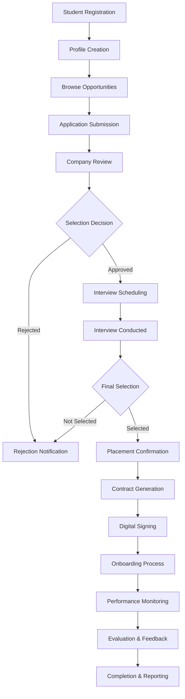
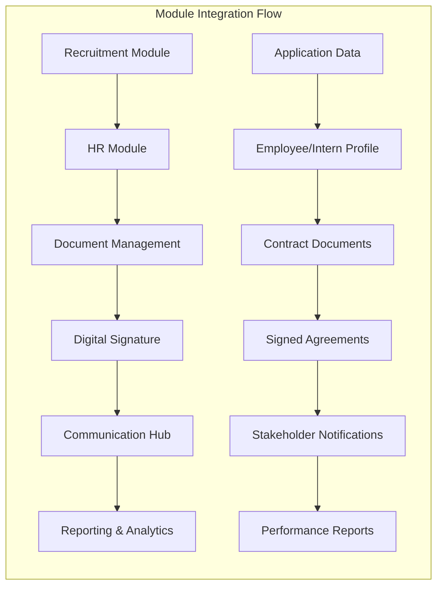

# AdmasAfroLink Business Logic Workflow & Module Customization Strategy

## 🔄 Core Business Logic Flow Architecture



## 🏗️ Odoo Module Integration & Customization Map

### Phase 1: Core Module Foundation (Hours 0-6)

#### 1.1 Recruitment Module Customization
**Standard Odoo → AdmasAfroLink Context**
```yaml
Customizations Required:
  Terminology Changes:
    - "Job Position" → "Internship Opportunity"
    - "Applicant" → "Student Applicant"
    - "Hired" → "Placed"
    - "Employee" → "Intern"
    
  New Fields:
    - Academic Institution
    - Study Program
    - Academic Level (Bachelor/Master/PhD)
    - Expected Graduation Date
    - Academic Supervisor Contact
    - University Coordinator
    
  Pipeline Stages:
    - New Application
    - Document Verification
    - University Pre-approval
    - Company Review
    - Interview Scheduled
    - Interview Completed
    - Final Selection
    - Placement Confirmed
    - Contract Signed
    - Onboarding Started
```

#### 1.2 HR Module Extension
**Employee → Intern Profile Management**
```yaml
Custom Models Required:
  Student Profile:
    - Personal Information
    - Academic History
    - Skills & Competencies
    - Certifications
    - Language Proficiency
    - Emergency Contacts
    
  Host Organization Profile:
    - Company Information
    - Industry Sector
    - Available Departments
    - Supervision Capacity
    - Past Intern Feedback
    - Compliance Status
    
  Internship Agreement:
    - Duration & Schedule
    - Learning Objectives
    - Performance Metrics
    - Compensation Details
    - Insurance Coverage
    - Termination Conditions
```

### Phase 2: Advanced Workflow Automation (Hours 6-12)

#### 2.1 Automated Action Triggers
```python
# Example Automated Actions Configuration

# 1. Application Submission Trigger
{
    'name': 'Student Application Confirmation',
    'model_id': 'hr.applicant',
    'trigger': 'on_create',
    'condition': '[("state", "=", "new")]',
    'actions': [
        'send_confirmation_email',
        'notify_university_coordinator',
        'create_application_tracking'
    ]
}

# 2. Company Review Notification
{
    'name': 'Company Review Alert',
    'model_id': 'hr.applicant',
    'trigger': 'on_write',
    'condition': '[("state", "=", "company_review")]',
    'actions': [
        'notify_company_hr',
        'schedule_review_reminder',
        'update_dashboard_metrics'
    ]
}

# 3. Placement Confirmation Workflow
{
    'name': 'Placement Confirmation Process',
    'model_id': 'hr.applicant',
    'trigger': 'on_write',
    'condition': '[("state", "=", "hired")]',
    'actions': [
        'create_intern_employee_record',
        'generate_contract_template',
        'trigger_onboarding_workflow',
        'notify_all_stakeholders'
    ]
}
```

#### 2.2 Integration Workflow Map


### Phase 3: Security & Access Control Implementation (Hours 12-15)

#### 3.1 User Group Definitions
```xml
<!-- Security Groups Configuration -->
<record id="group_student_portal" model="res.groups">
    <field name="name">Student Portal Users</field>
    <field name="category_id" ref="base.module_category_internship"/>
    <field name="implied_ids" eval="[(4, ref('base.group_portal'))]"/>
</record>

<record id="group_company_supervisor" model="res.groups">
    <field name="name">Company Supervisors</field>
    <field name="category_id" ref="base.module_category_internship"/>
    <field name="implied_ids" eval="[(4, ref('base.group_user'))]"/>
</record>

<record id="group_university_coordinator" model="res.groups">
    <field name="name">University Coordinators</field>
    <field name="category_id" ref="base.module_category_internship"/>
    <field name="implied_ids" eval="[(4, ref('base.group_user'))]"/>
</record>
```

#### 3.2 Record Rules for Data Segregation
```xml
<!-- Student can only see their own applications -->
<record id="rule_student_own_applications" model="ir.rule">
    <field name="name">Students: Own Applications Only</field>
    <field name="model_id" ref="hr.model_hr_applicant"/>
    <field name="domain_force">[('partner_id.user_ids', 'in', [user.id])]</field>
    <field name="groups" eval="[(4, ref('group_student_portal'))]"/>
</record>

<!-- Company users see only their company's applications -->
<record id="rule_company_own_applications" model="ir.rule">
    <field name="name">Company: Own Company Applications</field>
    <field name="model_id" ref="hr.model_hr_applicant"/>
    <field name="domain_force">[('company_id', '=', user.company_id.id)]</field>
    <field name="groups" eval="[(4, ref('group_company_supervisor'))]"/>
</record>
```

### Phase 4: Document Management & E-Signatures (Hours 15-18)

#### 4.1 Document Workflow Configuration
```yaml
Document Categories:
  Student Documents:
    - CV/Resume
    - Academic Transcripts
    - Recommendation Letters
    - Portfolio/Work Samples
    - Insurance Documents
    
  Legal Documents:
    - Internship Agreements
    - Non-Disclosure Agreements
    - University MOUs
    - Consent Forms
    - Privacy Policy Acknowledgments
    
  Evaluation Documents:
    - Performance Reviews
    - Academic Reports
    - Supervisor Feedback
    - Student Reflection Papers
    - Completion Certificates

Approval Workflows:
  Contract Approval Chain:
    1. University Coordinator Review
    2. Legal Department Approval
    3. Company HR Approval
    4. Student Acceptance
    5. Final Document Archive
```

#### 4.2 Digital Signature Integration
```python
# Odoo Sign Integration for Contracts
class InternshipContract(models.Model):
    _name = 'internship.contract'
    _inherit = ['mail.thread', 'mail.activity.mixin']
    
    def generate_and_send_contract(self):
        """Generate contract from template and send for signatures"""
        template = self.env.ref('internship_management.contract_template')
        
        # Create sign request
        sign_request = self.env['sign.request'].create({
            'template_id': template.id,
            'reference': f"Internship Contract - {self.student_id.name}",
            'request_item_ids': [
                (0, 0, {
                    'partner_id': self.student_id.partner_id.id,
                    'role_id': self.env.ref('sign.sign_item_role_student').id,
                }),
                (0, 0, {
                    'partner_id': self.company_supervisor_id.partner_id.id,
                    'role_id': self.env.ref('sign.sign_item_role_supervisor').id,
                }),
            ]
        })
        
        # Send for signature
        sign_request.action_sent()
        return sign_request
```

### Phase 5: Communication & Collaboration Setup (Hours 18-21)

#### 5.1 Discuss Channel Configuration
```python
# Automated Channel Creation
def create_internship_channels(self):
    """Create dedicated communication channels for internship"""
    
    # Main internship coordination channel
    coordination_channel = self.env['mail.channel'].create({
        'name': f'Internship - {self.student_id.name} @ {self.company_id.name}',
        'channel_type': 'chat',
        'public': 'private',
        'channel_partner_ids': [
            (4, self.student_id.partner_id.id),
            (4, self.company_supervisor_id.partner_id.id),
            (4, self.university_coordinator_id.partner_id.id),
        ]
    })
    
    # Company-specific channels
    company_channel = self.env['mail.channel'].create({
        'name': f'Company Team - {self.company_id.name}',
        'channel_type': 'channel',
        'public': 'groups',
        'group_public_id': self.env.ref('group_company_supervisor').id,
    })
```

#### 5.2 Notification Framework
```yaml
Notification Triggers:
  Student Notifications:
    - Application Status Updates
    - Interview Invitations
    - Contract Availability
    - Performance Review Reminders
    - Completion Milestones
    
  Company Notifications:
    - New Applications Received
    - University Approval Confirmations
    - Document Upload Alerts
    - Evaluation Due Dates
    - Contract Expiry Warnings
    
  University Notifications:
    - Student Application Submissions
    - Company Feedback Requests
    - Academic Progress Reports
    - Compliance Updates
    - System Audit Alerts
```

### Phase 6: Reporting & Analytics (Hours 21-24)

#### 6.1 Custom Dashboard Development
```python
# KPI Dashboard Configuration
class InternshipDashboard(models.Model):
    _name = 'internship.dashboard'
    
    @api.model
    def get_dashboard_data(self):
        return {
            'total_applications': self._get_total_applications(),
            'placement_rate': self._get_placement_rate(),
            'student_satisfaction': self._get_satisfaction_score(),
            'company_participation': self._get_company_stats(),
            'university_engagement': self._get_university_stats(),
            'compliance_status': self._get_compliance_metrics(),
        }
    
    def _get_placement_rate(self):
        """Calculate placement success rate"""
        total_apps = self.env['hr.applicant'].search_count([])
        placed_apps = self.env['hr.applicant'].search_count([
            ('stage_id.hired_stage', '=', True)
        ])
        return (placed_apps / total_apps * 100) if total_apps > 0 else 0
```

#### 6.2 Compliance Reporting Framework
```yaml
Compliance Reports:
  Data Protection Audit:
    - Consent Records Tracking
    - Data Access Logs
    - Privacy Policy Updates
    - Breach Incident Reports
    - Data Retention Compliance
    
  Academic Compliance:
    - Learning Objective Achievement
    - University Standards Adherence
    - Academic Credit Validation
    - Supervisor Qualification Tracking
    - Quality Assurance Metrics
    
  Legal Compliance:
    - Contract Validity Checks
    - Insurance Coverage Verification
    - Employment Law Adherence
    - Safety Protocol Compliance
    - Regulatory Requirement Updates
```

## 🚀 Implementation Roadmap

### Quick Start Checklist (24-Hour Build)

#### Hours 0-6: Foundation Setup
- [ ] Core Odoo installation and configuration
- [ ] Basic module structure creation
- [ ] Database schema customization
- [ ] Initial security group setup

#### Hours 6-12: Core Functionality
- [ ] Student registration and profile management
- [ ] Company onboarding and opportunity posting
- [ ] Application submission and tracking workflow
- [ ] Basic communication setup

#### Hours 12-18: Advanced Features
- [ ] Document management and digital signatures
- [ ] Performance evaluation system
- [ ] Automated notification system
- [ ] Reporting dashboard development

#### Hours 18-24: Testing & Deployment
- [ ] End-to-end workflow testing
- [ ] Security and access control verification
- [ ] Performance optimization
- [ ] Production deployment and monitoring

## 🔧 Technical Architecture

### Module Dependencies
```python
{
    'name': 'AdmasAfroLink Internship Management',
    'depends': [
        'base',
        'hr',
        'hr_recruitment',
        'documents',
        'sign',
        'mail',
        'portal',
        'website',
        'hr_appraisal',
        'calendar',
        'project',
        'web_enterprise',
    ],
    'data': [
        'security/security.xml',
        'security/ir.model.access.csv',
        'data/email_templates.xml',
        'data/automated_actions.xml',
        'views/student_views.xml',
        'views/company_views.xml',
        'views/internship_views.xml',
        'views/dashboard_views.xml',
        'reports/internship_reports.xml',
    ],
    'demo': [
        'demo/demo_data.xml',
    ],
    'installable': True,
    'application': True,
    'auto_install': False,
}
```

### Database Schema Extensions
```sql
-- Custom tables for internship management
CREATE TABLE internship_opportunity (
    id SERIAL PRIMARY KEY,
    name VARCHAR(255) NOT NULL,
    company_id INTEGER REFERENCES res_company(id),
    department_id INTEGER REFERENCES hr_department(id),
    academic_level VARCHAR(50),
    duration_months INTEGER,
    start_date DATE,
    application_deadline DATE,
    required_skills TEXT,
    learning_objectives TEXT,
    supervisor_id INTEGER REFERENCES hr_employee(id),
    state VARCHAR(50) DEFAULT 'draft'
);

CREATE TABLE student_application (
    id SERIAL PRIMARY KEY,
    student_id INTEGER REFERENCES res_partner(id),
    opportunity_id INTEGER REFERENCES internship_opportunity(id),
    application_date TIMESTAMP DEFAULT NOW(),
    motivation_letter TEXT,
    cv_document_id INTEGER REFERENCES ir_attachment(id),
    transcript_document_id INTEGER REFERENCES ir_attachment(id),
    state VARCHAR(50) DEFAULT 'submitted',
    university_coordinator_id INTEGER REFERENCES res_partner(id)
);
```

This comprehensive workflow provides a complete blueprint for implementing the AdmasAfroLink internship platform with proper module integration, security, and compliance features aligned with Ugandan legal requirements.
