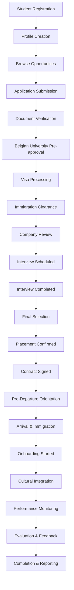

# AdmasAfroLink Frontend Development Prompt
## Student-Centered UI/UX Platform Design

### 🎯 Project Brief
Create a modern, intuitive frontend platform for **AdmasAfroLink** - an international student internship placement system connecting Belgian university students with internship opportunities in Uganda. The platform must provide a seamless, user-friendly experience that guides students through a complex multi-stage workflow while maintaining cultural sensitivity and accessibility.

### 👥 Primary User Persona
**Belgian University Students (Ages 19-25)**
- Tech-savvy but may be unfamiliar with African business culture
- Need clear guidance through international internship process
- Require mobile-responsive design for on-the-go access
- Expect modern, clean, and intuitive interfaces
- Need multilingual support (English/French)
- Value transparency and real-time status updates

### 🔄 Core Workflow Integration
Design the frontend to seamlessly support this student journey:



### 🎨 Design Requirements

#### Visual Identity
- **Brand Colors**: Modern, trustworthy palette reflecting both Belgian and Ugandan cultural elements
- **Typography**: Clean, readable fonts supporting multiple languages
- **Iconography**: Universal symbols with cultural sensitivity
- **Photography**: Diverse, authentic imagery of students and African work environments

#### Layout Principles
- **Mobile-First Design**: Responsive across all devices
- **Progressive Disclosure**: Complex information revealed gradually
- **Clear Navigation**: Always know where you are in the process
- **Status Visibility**: Real-time progress indicators throughout workflow

### 📱 Key Frontend Components

#### 1. Student Dashboard
```
Features Required:
- Progress tracker showing current workflow stage
- Quick actions for next steps
- Notification center with real-time updates
- Document upload status
- Application timeline view
- Cultural integration resources
- Emergency contacts (Uganda & Belgium)
```

#### 2. Application Portal
```
User Experience Flow:
- Guided form completion with progress saving
- Document drag-and-drop upload with validation
- Real-time application status updates
- Integration with Belgian university systems
- Automated email confirmations
- Mobile-optimized for on-the-go completion
```

#### 3. Opportunity Discovery
```
Interface Components:
- Advanced filtering (location, industry, duration)
- Map integration showing Uganda locations
- Company profiles with cultural insights
- Internship matching algorithm suggestions
- Saved opportunities wishlist
- Social sharing capabilities
```

#### 4. Communication Hub
```
Chat & Messaging Features:
- Direct messaging with university coordinators
- Group channels for Belgian student cohorts
- Video call integration for interviews
- Cultural mentorship connections
- Language translation assistance
- Time zone aware scheduling
```

#### 5. Document Management
```
Document Workflow:
- Secure document upload with encryption
- Digital signature integration
- Version control for contract revisions
- Automatic backup to cloud storage
- Progress tracking for approval chains
- Mobile document scanning capabilities
```

#### 6. Cultural Integration Center
```
Learning Modules:
- Uganda cultural orientation videos
- Business etiquette guidelines
- Language learning resources
- Local customs and traditions
- Safety and emergency procedures
- Success stories from previous students
```

### 🛠 Technical Specifications

#### Frontend Technology Stack
```yaml
Framework: React.js / Vue.js / Angular
Styling: Tailwind CSS / Material-UI / Ant Design
State Management: Redux / Vuex / NgRx
Mobile: React Native / Flutter (for mobile app)
Real-time: Socket.io / WebSockets
Charts: Chart.js / D3.js for analytics
Maps: Google Maps / OpenStreetMap
Video: WebRTC for interviews
```

#### Backend Integration
```yaml
API Integration:
  - RESTful APIs with Odoo backend
  - GraphQL for complex data queries
  - WebSocket connections for real-time updates
  - OAuth2 for Belgian university SSO
  - File upload with progress tracking
  - Push notifications for mobile
```

#### Accessibility & Internationalization
```yaml
Accessibility:
  - WCAG 2.1 AA compliance
  - Screen reader compatibility
  - Keyboard navigation support
  - High contrast mode option
  - Text size adjustment

Internationalization:
  - English/French language toggle
  - RTL text support preparation
  - Localized date/time formats
  - Currency conversion display
  - Cultural appropriate imagery
```

### 🎯 Specific Page/Component Requirements

#### Registration & Onboarding
```
Design Elements:
- Welcome video from successful Belgian interns
- Step-by-step registration wizard
- Belgian university verification integration
- Profile photo upload with guidelines
- Emergency contact form (Belgium & Uganda)
- Initial cultural assessment questionnaire
```

#### Application Tracking Dashboard
```
Visual Components:
- Interactive progress bar with stage descriptions
- Status cards with actionable next steps
- Document checklist with completion indicators
- Timeline view of application history
- Notification center with filtering options
- Quick help tooltips and guidance
```

#### Interview Preparation Center
```
Features:
- Video interview testing platform
- Cultural preparation materials
- Common interview questions database
- Practice interview scheduling
- Technical setup verification
- Interview feedback collection
```

#### Pre-Departure Portal
```
Checklist Components:
- Visa status tracker
- Travel documentation checklist
- Packing guidelines for Uganda
- Airport pickup coordination
- Accommodation confirmation
- Local contact information
- Emergency procedures overview
```

### 📊 Analytics & Reporting

#### Student Analytics Dashboard
```
Metrics to Display:
- Application completion rate
- Time spent in each workflow stage
- Document upload success rate
- Interview performance scores
- Cultural integration progress
- Peer comparison (anonymized)
```

#### Engagement Tracking
```
User Behavior Metrics:
- Page visit patterns
- Feature usage statistics
- Drop-off points identification
- Support request patterns
- Mobile vs desktop usage
- Language preference analytics
```

### 🔒 Security & Privacy

#### Data Protection
```
Implementation Requirements:
- GDPR compliance for Belgian students
- Uganda Data Protection Act compliance
- End-to-end encryption for sensitive documents
- Secure authentication (2FA support)
- Session management and timeout
- Audit trails for all data access
```

#### User Privacy
```
Privacy Features:
- Granular privacy settings
- Data export functionality
- Account deletion options
- Consent management interface
- Anonymous feedback options
- Secure communication channels
```

### 🎨 UI/UX Design Patterns

#### Color Scheme
```css
Primary Colors:
- Belgian Blue: #003366 (trust, professionalism)
- Uganda Gold: #FCDC00 (optimism, energy)
- Success Green: #28A745 (progress, completion)
- Warning Orange: #FD7E14 (attention, action needed)
- Error Red: #DC3545 (alerts, issues)

Neutral Colors:
- Dark Gray: #343A40 (text, headings)
- Medium Gray: #6C757D (secondary text)
- Light Gray: #F8F9FA (backgrounds)
- White: #FFFFFF (cards, modals)
```

#### Typography
```css
Fonts:
- Headers: 'Poppins' (modern, friendly)
- Body: 'Inter' (readable, international)
- Monospace: 'Fira Code' (technical content)

Font Scales:
- H1: 2.5rem (40px) - Page titles
- H2: 2rem (32px) - Section headers
- H3: 1.5rem (24px) - Sub-sections
- Body: 1rem (16px) - Main content
- Small: 0.875rem (14px) - Captions
```

#### Component Library
```
Design System Components:
- Buttons (primary, secondary, ghost, danger)
- Form inputs (text, select, file upload, date)
- Cards (info, action, status, profile)
- Modals (confirmation, forms, media)
- Navigation (breadcrumbs, tabs, sidebar)
- Indicators (progress, status, badges)
- Tooltips (help, validation, guidance)
```

### 📱 Mobile Optimization

#### Mobile-First Features
```
Priority Mobile Features:
- Thumb-friendly touch targets (44px minimum)
- Swipe gestures for navigation
- Pull-to-refresh functionality
- Offline mode for key features
- Push notifications for status updates
- Camera integration for document scanning
- GPS integration for location services
```

#### Progressive Web App (PWA)
```
PWA Features:
- App-like installation on mobile devices
- Offline functionality for critical features
- Background sync for document uploads
- Push notifications for real-time updates
- Fast loading with service workers
- App icon and splash screen
```

### 🧪 Testing Requirements

#### User Testing
```
Testing Scenarios:
- First-time Belgian student registration
- Document upload and verification process
- Interview scheduling across time zones
- Mobile application completion
- Cultural orientation module completion
- Emergency contact procedures
```

#### Performance Testing
```
Performance Metrics:
- Page load time < 3 seconds
- Document upload progress indication
- Real-time notification delivery
- Cross-browser compatibility testing
- Mobile performance optimization
- API response time monitoring
```

### 🚀 Development Phases

#### Phase 1: Core Platform (Weeks 1-4)
```
Deliverables:
- User registration and authentication
- Basic profile management
- Opportunity browsing interface
- Simple application submission
- Document upload functionality
- Basic notification system
```

#### Phase 2: Enhanced Features (Weeks 5-8)
```
Deliverables:
- Advanced workflow tracking
- Interview scheduling system
- Document management portal
- Communication hub
- Cultural integration center
- Mobile optimization
```

#### Phase 3: Advanced Features (Weeks 9-12)
```
Deliverables:
- Analytics dashboard
- Advanced search and filtering
- Video interview platform
- Offline capabilities
- Multi-language support
- Performance optimization
```

### 💡 Innovation Opportunities

#### AI-Powered Features
```
Potential Integrations:
- Chatbot for 24/7 student support
- Document auto-filling using OCR
- Intelligent opportunity matching
- Automated interview scheduling
- Cultural adaptation recommendations
- Predictive analytics for success rates
```

#### Social Features
```
Community Building:
- Belgian student mentor network
- Alumni success story sharing
- Peer-to-peer support forums
- Cultural exchange discussions
- Photo sharing from Uganda experiences
- Virtual meetups and events
```

### 🎯 Success Metrics

#### User Experience KPIs
```
Measurement Criteria:
- Registration completion rate > 85%
- Application submission rate > 75%
- User satisfaction score > 4.5/5
- Mobile usage rate > 60%
- Support ticket reduction > 40%
- Time-to-complete application < 30 minutes
```

#### Technical Performance KPIs
```
Performance Metrics:
- Page load time < 3 seconds
- Uptime > 99.5%
- Mobile responsiveness score > 90%
- Accessibility score > 95%
- Security audit compliance 100%
- Cross-browser compatibility 100%
```

---

**Budget Estimate:** €15,000 - €25,000
**Timeline:** 12 weeks development + 4 weeks testing
**Team Size:** 3-5 developers (Frontend, Backend, UI/UX, QA)
**Maintenance:** Ongoing support and feature updates

This prompt provides a comprehensive foundation for creating a student-centered frontend platform that addresses the unique needs of Belgian students pursuing internships in Uganda through the AdmasAfroLink system.

## 🚀 Quick Start Implementation Guide

### Day 1-3: Project Setup
```bash
# 1. Initialize React/Next.js project
npx create-next-app@latest admasafrolink-frontend
cd admasafrolink-frontend

# 2. Install core dependencies
npm install @mui/material @emotion/react @emotion/styled
npm install react-query axios socket.io-client
npm install @mui/icons-material react-hook-form
npm install i18next react-i18next

# 3. Setup project structure
mkdir -p src/{components,pages,hooks,utils,services,types}
mkdir -p src/components/{dashboard,application,communication,documents}
```

### Week 1: Core Architecture
```typescript
// Setup TypeScript interfaces
interface Student {
  id: string;
  name: string;
  university: string;
  email: string;
  applicationStage: WorkflowStage;
  documents: Document[];
}

interface WorkflowStage {
  id: number;
  name: string;
  status: 'pending' | 'in-progress' | 'completed' | 'blocked';
  nextAction: string;
  estimatedDuration: string;
}
```

### Priority Components to Build First:
1. **Authentication & Registration** (Week 1)
2. **Student Dashboard** (Week 2)
3. **Application Portal** (Week 3)
4. **Document Upload** (Week 4)

### Critical Success Factors:
✅ **Mobile-First Design**: 70% of students will access via mobile  
✅ **Real-Time Updates**: WebSocket integration for live status  
✅ **Offline Capabilities**: PWA for unreliable internet  
✅ **Multi-Language**: French/English toggle from day one  
✅ **Cultural Sensitivity**: Uganda-aware design and content  

### Immediate Next Steps:
1. **Designer**: Create wireframes for top 5 user journeys
2. **Frontend Dev**: Setup React + TypeScript + Material-UI
3. **Backend Dev**: Prepare Odoo API endpoints for student data
4. **PM**: Schedule weekly demos with Belgian university stakeholders

This comprehensive prompt ensures your development team can immediately begin creating an exceptional user experience that serves the unique needs of Belgian students pursuing life-changing internship opportunities in Uganda.
